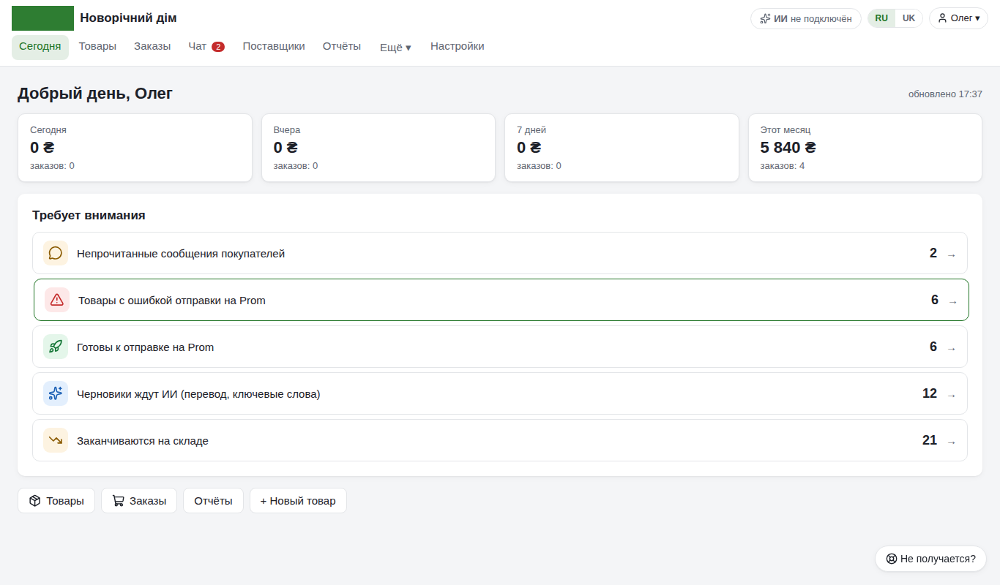
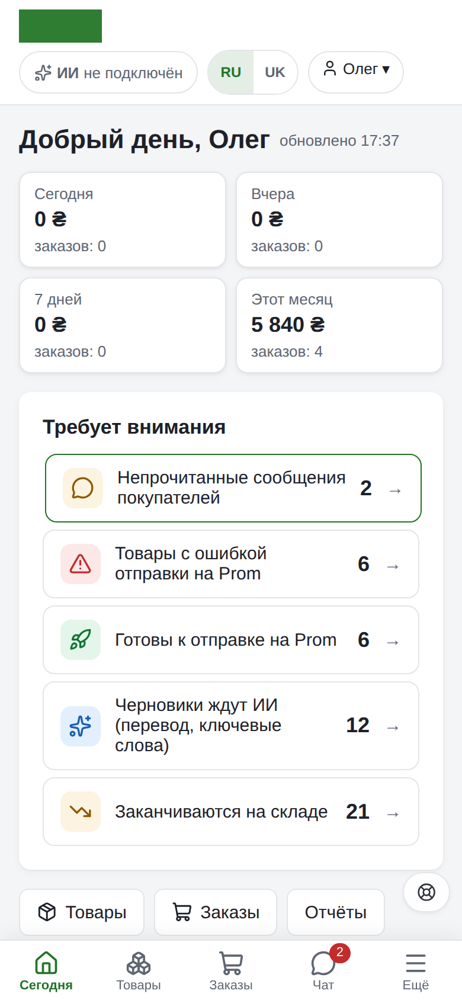
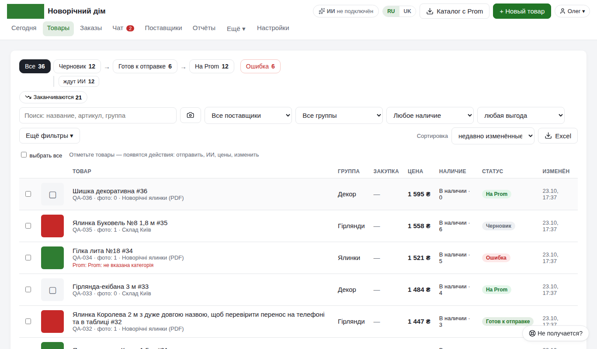
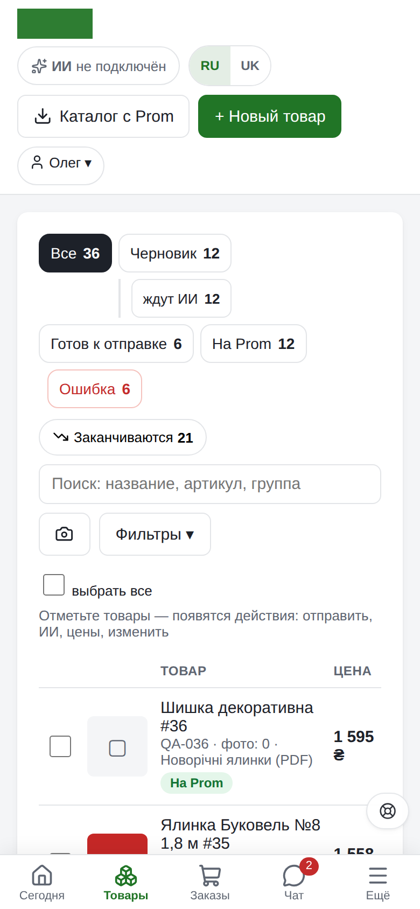
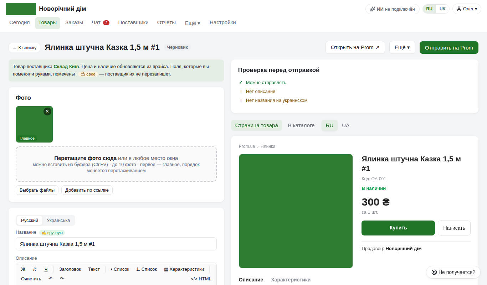
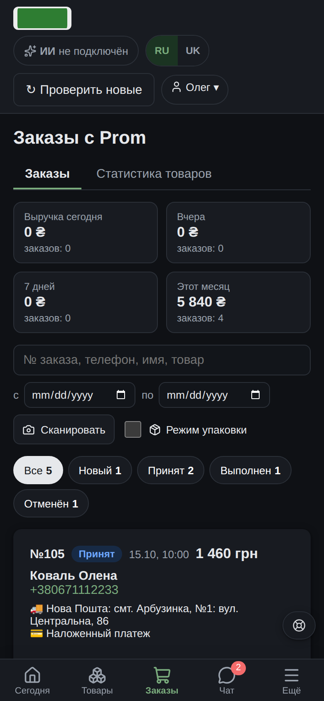
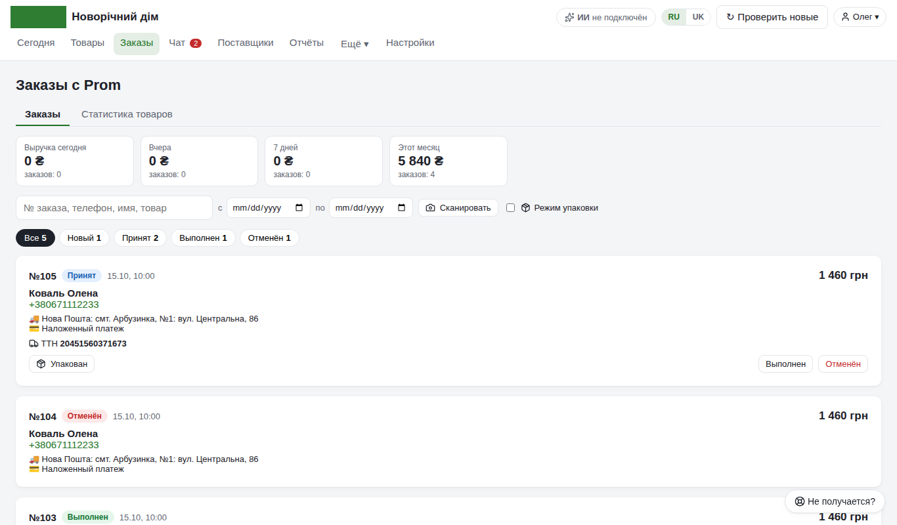
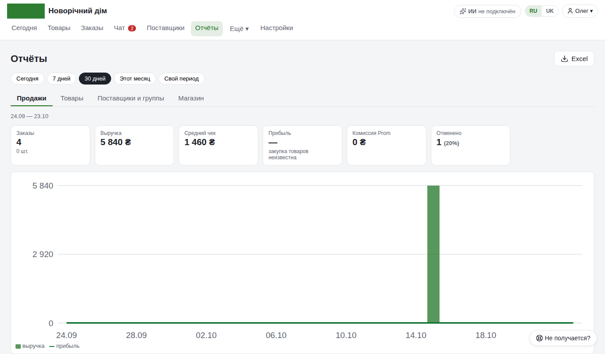
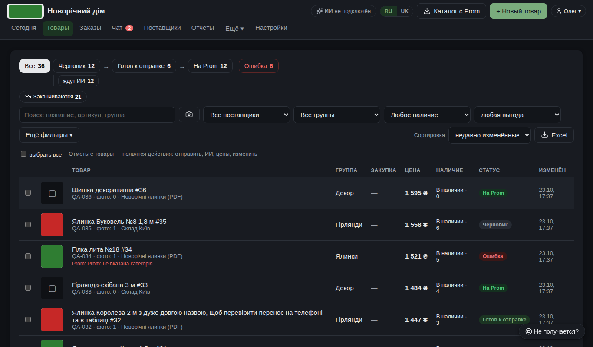
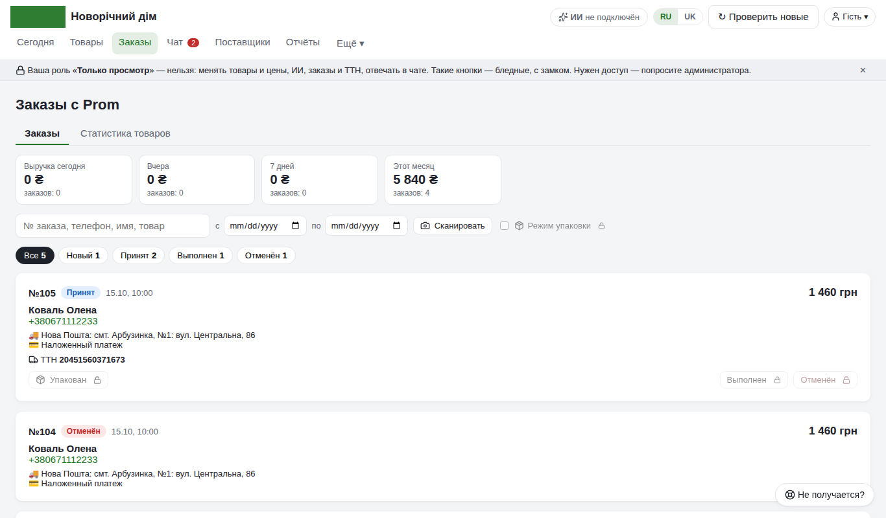

# Карта Prom Loader

Что где лежит, кто что видит и как программа выглядит на разных экранах. Проверено обходом в браузере (2.29.3):
4 роли × 7 экранов (1920, 1366, 1024, iPad 820, iPhone 390, Android 360, 320) + тёмная тема + украинский язык —
все страницы, вкладки «Настроек» и «Отчётов», меню «Ещё».

## Как выглядит

| Компьютер | Телефон |
|---|---|
|  «Сегодня» |  |
|  «Товары» |  |
|  Карточка товара |  |
|  «Заказы» | |
|  «Отчёты» | |
|  Тёмная тема | |
|  Роль «Только просмотр»: кнопки с замком | |

Снимки — на демо-магазине; обновляются вместе с заметными изменениями вида.

## Общее на каждой странице

| Элемент | Где | Что делает |
|---|---|---|
| Логотип магазина | шапка слева | ведёт на «Сегодня» |
| Меню | шапка | Сегодня · Товары · Заказы · Чат · Отзывы · Поставщики · Отчёты · **Ещё ▾** · Настройки |
| «Ещё ▾» | в меню (компьютер) | Наценка, Категории, Журнал, Импорт файла, Проверка выгрузки, Поддержка |
| Нижняя панель | телефон (до 640 px) | Сегодня · Товары · Заказы · Чат · **Ещё** (открывает всё меню сверху) |
| ✨ ИИ | шапка справа | модель, расходы, лимиты, «Один поток / Много потоков» — окно с любой страницы; ключи — только в «Настройках» |
| RU / UK | шапка справа | язык интерфейса (у каждого свой, на его устройстве) |
| 👤 Имя ▾ | шапка справа | роль, тема ☀ / ☾ / Авто, смена пароля, «Пользователи» (админ), «Выйти» |
| 🆘 | правый нижний угол | «Не получается?» — обращение со скриншотом и журналом |
| Строка роли | под шапкой | у урезанных ролей: «Ваша роль … — нельзя: …»; кнопки без права — бледные с замком |

## Страницы

| Адрес | Раздел | Что внутри |
|---|---|---|
| `/today` | **Сегодня** | итоги заказов (сегодня, вчера, 7 дней, месяц) и «Требует внимания» — каждый пункт ведёт в нужный список |
| `/` | **Товары** | поиск, конвейер этапов (черновики → готов → на Prom, ошибки) с действием этапа, фильтры, список; при выборе — массовые действия: отправить, ИИ, цены, изменить, «Ещё ▾» (готов / вернуть / в черновики / удалить) |
| `/product?id=…` | Карточка товара | ← Пред. / След. →, фото, ✨ ИИ-помощник, цена и наличие, каталог и категория Prom, характеристики, описание RU/UA, видео, история изменений, проверка перед отправкой; «Отправить на Prom», «Открыть на Prom», «Ещё ▾» (проверка выгрузки, дублировать, удалить) |
| `/orders` | **Заказы** | вкладки «Заказы» / «Статистика товаров»; поиск, даты, 📷 скан ТТН, режим упаковки; у заказа — статус, «Упакован», ТТН Новой Почты, напоминание и предоплата в чат |
| `/chat` | **Чат** | диалоги с покупателями (все / непрочитанные), товар и заказ диалога, готовые ответы, ✨ «Предложить ответ» |
| `/reviews` | **Отзывы** | вкладки «Отзывы» (средняя оценка, фильтры без ответа / негативные / с текстом / новые, черновик ответа + «Скопировать» + «Ответить на Prom ↗») и «Сообщения с сайта» (ответ, ✨, «Прочитано») |
| `/suppliers` | **Поставщики** | список прайсов, «Обновить сейчас», «Настроить» |
| `/supplier?id=…` | Поставщик | 1. откуда прайс, 2. колонки, 3. как обновлять; проверка, «Что изменится», удалённые вами товары, 📦 заказ поставщику, история |
| `/reports` | **Отчёты** | период + вкладки «Продажи», «Товары», «Поставщики и группы», «Магазин»; Excel на каждой |
| `/pricing` | Наценка (Ещё) | курс валют, правила наценки, сторож наценки, «Проверить расчёт» |
| `/categories` | Категории (Ещё) | категория Prom для каждой группы, расхождения, Excel для кабинета |
| `/changes` | Журнал (Ещё) | кто, что и когда поменял, «↩ Вернуть» |
| `/import` | Импорт файла (Ещё) | разовый импорт Excel / CSV / XML с фото из файла |
| `/diagnose` | Проверка выгрузки (Ещё) | один товар по шагам до Prom: что уйдёт и что ответит Prom |
| `/support` | Поддержка (Ещё) | обращения и диагностика |
| `/settings` | **Настройки** | вкладки ниже |
| `/login` | Вход | логин и пароль, сброс пароля; большой логотип на фоне |

### Вкладки «Настроек» (только администратор)

| Вкладка | Что там |
|---|---|
| 🛒 Prom и магазин | токен Prom, фото для Prom, выгрузка по расписанию, синхронизация с кабинетом |
| ✨ ИИ | ключи Gemini / Claude (основной и запасные — переключение по лимиту), модель, темп и «Один поток / Много потоков» массового ИИ |
| 📨 Уведомления | Telegram, получатели, сводка дня; 📲 приложение на телефоне и push |
| 🚚 Новая Почта | ключ API, отправитель, отделение |
| 👥 Пользователи и доступ | пользователи и роли; 📱 доступ с телефона (Wi‑Fi дома / Cloudflare из любого места) |
| 🎨 Оформление | тема, логотип и большой логотип, цвет из логотипа, компактный список |
| 🔧 Обслуживание | обновления, резервные копии, переезд, автоимпорт, дополнительно |

## Кто что видит

Готовые роли: **Администратор** (всё), **Менеджер** (товары, ИИ, заказы, чат), **Оператор заказов** (заказы, чат),
**Только просмотр** (ничего не меняет). Свою роль можно собрать из прав в «Пользователи и доступ».

| Раздел | Администратор | Менеджер | Оператор заказов | Только просмотр |
|---|---|---|---|---|
| Сегодня, Отчёты, Журнал, Проверка выгрузки | ✓ | ✓ | ✓ смотрит | ✓ смотрит |
| Товары и карточка | ✓ | ✓ | 👁 кнопки с замком | 👁 кнопки с замком |
| Заказы, ТТН, «Упакован» | ✓ | ✓ | ✓ | 👁 кнопки с замком |
| Чат: ответить, напомнить | ✓ | ✓ | ✓ | 👁 «Отправить» с замком |
| Отзывы: черновик, ответ на сообщение с сайта | ✓ | ✓ | ✓ | 👁 поля и кнопки с замком |
| ✨ ИИ (карточка, массовый, черновик ответа) | ✓ | ✓ | 🔒 | 🔒 |
| Поставщики, Наценка, Категории | ✓ | ✓ | 👁 только просмотр (поля закрыты; «Проверить расчёт» работает) | 👁 то же |
| Импорт файла | ✓ | ✓ | нет в меню, по ссылке — «Нет доступа» | то же |
| Настройки, Поддержка | ✓ | нет в меню, по ссылке — «Нет доступа» | то же | то же |

«Нет доступа» — страница с объяснением, какого права не хватает, и кнопкой «← На главную «Сегодня»».

## Экраны и устройства

| Ширина | Как выглядит |
|---|---|
| больше 1440 px | меню в одну строку с шапкой |
| 641–1440 px (ноутбук, планшет) | меню — второй строкой; редкие разделы в «Ещё ▾» (список поверх страницы) |
| до 640 px (телефон) | меню сверху скрыто, внизу панель Сегодня · Товары · Заказы · Чат · Ещё; списки — карточками; «Действия ▾» вместо ряда кнопок; 🆘 без подписи |
| сенсорный экран | все кнопки не меньше 36 px под палец |

Тёмная тема — в меню 👤 или «Оформление»; превью страницы Prom остаётся светлым, как на самом Prom.

## Адреса программы

| Откуда | Адрес | Вход |
|---|---|---|
| сам компьютер | `http://localhost:8000/` (порт может быть 8001–8010) | логин и пароль |
| телефон дома по Wi‑Fi | один адрес из «Доступ с телефона», например `http://192.168.50.102:8000/` | логин и пароль; уведомлений нет (нужен https) |
| телефон откуда угодно | адрес Cloudflare `https://….trycloudflare.com` (новый после перезапуска, приходит в Telegram) | логин и пароль; уведомления работают |

У компьютера может быть несколько сетевых адресов (VPN, Hyper‑V, WSL, VirtualBox), но телефон видит только один —
сеть роутера. Программа показывает его первым, а остальные — свёрнуто в «Другие адреса компьютера». Когда телефон
хоть раз открыл программу, его адрес помечается «✓ По этому адресу телефон уже открывал программу».
